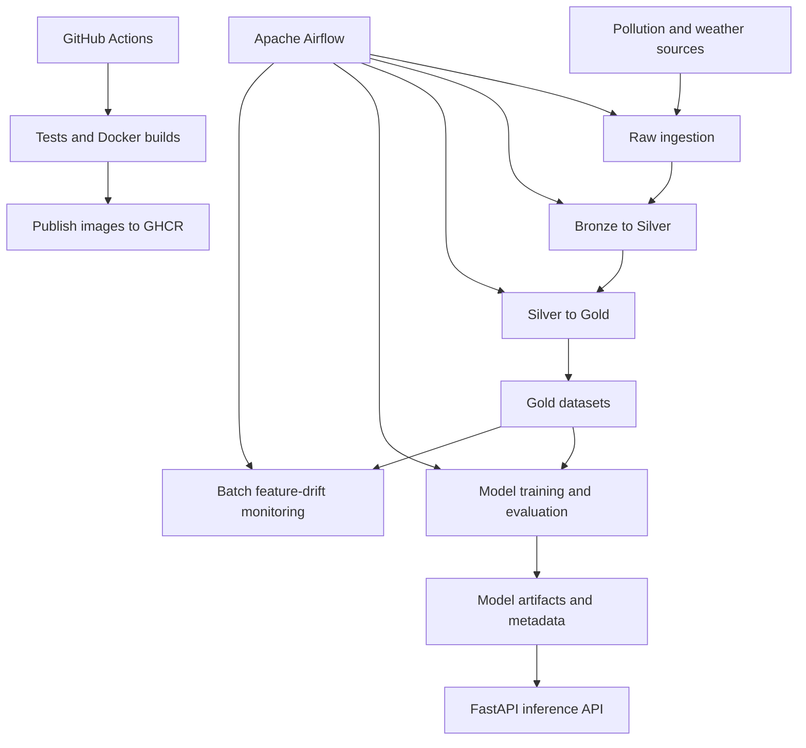

# AirSense - End-to-End MLOps for Air Quality Prediction

AirSense is an end-to-end MLOps project demonstrating how to build, package, serve, monitor, and continuously validate a machine-learning application for air-quality prediction.

It combines an orchestrated data pipeline, model training and evaluation, a FastAPI inference service, batch feature-drift monitoring, Docker images, and a GitHub Actions CI/CD workflow.

## Architecture



## Key Features

### Data pipeline
- Pollution and weather ingestion scripts.
- Bronze-to-Silver and Silver-to-Gold transformations.
- Data validation utilities.
- Airflow DAGs for ingestion and transformation orchestration.

### Model lifecycle
- Model training and evaluation workflow.
- Model selection/promotion logic based on evaluation metrics.
- Model artifacts and metadata used by the inference API.
- Airflow DAG for model training.

### Model serving
The FastAPI application exposes:

| Method | Endpoint | Purpose |
|---|---|---|
| `GET` | `/health` | Reports whether the model loaded successfully. Inspect `model_loaded`. |
| `GET` | `/model-info` | Returns model name, feature count, target columns, and evaluation metadata. |
| `POST` | `/predict` | Predicts target values for the next time step (`t+1`). |

Interactive documentation is available at `/docs` when the API is running. See [`docs/fastapi.md`](docs/fastapi.md) for full details.

`POST /predict` requires all feature names defined in `models/model_metadata.json` under `feature_columns`, with finite numeric values. Missing or unexpected features are rejected. The API predicts from values supplied in the request; it does not collect live sensor readings itself.

### Batch monitoring
- Feature-drift analysis using Evidently.
- An Airflow DAG that compares reference and current portions of Gold datasets.
- HTML and JSON reports.

This is batch monitoring, not continuous real-time monitoring. Drift reports indicate changes in feature distributions and do not, by themselves, prove model-performance degradation.

### CI/CD and containers
The workflow [`.github/workflows/docker_ci_cd.yml`](.github/workflows/docker_ci_cd.yml) runs on pushes to `main`, pull requests, and manual dispatches. It installs dependencies, checks dependency consistency, runs tests, builds and smoke-tests the API image, builds the Airflow image, and checks Airflow dependencies. Successful pushes to `main` publish the API and Airflow images to GitHub Container Registry (GHCR), tagged with `latest` and the commit SHA.

## Technology Stack

- **Python 3.10** — pipeline, validation, training, and API code.
- **Apache Airflow** — workflow orchestration.
- **FastAPI / Pydantic** — inference API and request validation.
- **pandas / NumPy** — tabular data processing.
- **joblib** — loading the trained model artifact.
- **Evidently** — batch feature-drift reports.
- **Docker** — containerized API and Airflow services.
- **MLflow** — experiment/model lifecycle tooling in the local stack.
- **GitHub Actions** — automated tests, image builds, and publishing.
- **GHCR** — published container images.

## Repository Structure

```text
AirSense/
├── .github/workflows/docker_ci_cd.yml
├── airflow/
│   ├── dags/
│   ├── Dockerfile
│   └── docker-compose.yaml
├── api/main.py
├── data/
├── docs/fastapi.md
├── models/
├── scripts/
│   ├── ingestion/
│   ├── transformation/
│   ├── training/
│   └── validation/
├── tests/
├── Dockerfile.api
├── requirements.txt
└── README.md
```

Runtime data, logs, model artifacts, and generated reports may be created during execution and are not all intended to be committed to Git.

## Prerequisites

- Git
- Python 3.10
- Docker and Docker Compose
- Source data and model artifacts as required by the selected workflow

## Local Setup

```bash
git clone https://github.com/BadreddinB/AirSense.git
cd AirSense
python3.10 -m venv .venv
source .venv/bin/activate
python -m pip install --upgrade pip
pip install -r requirements.txt
```

Run the automated tests:

```bash
python -m pytest -q
```

The test suite covers ingestion, transformations, data validation, and model-training behavior.

## Run the FastAPI Service

Ensure these artifacts exist:

- `models/best_model.joblib`
- `models/model_metadata.json`

Start the API from the repository root:

```bash
uvicorn api.main:app --host 0.0.0.0 --port 8000
```

Useful URLs:

- Health: `http://localhost:8000/health`
- Model information: `http://localhost:8000/model-info`
- Interactive documentation: `http://localhost:8000/docs`

Example:

```bash
curl http://localhost:8000/health
```

Inspect `model_loaded` in the response; HTTP 200 alone does not guarantee the model loaded successfully. Artifact paths can be overridden with `MODEL_PATH` and `METADATA_PATH`. See [`docs/fastapi.md`](docs/fastapi.md) for request schemas, response examples, validation, and errors.

## Run the Airflow Stack

From the repository root:

```bash
docker compose -f airflow/docker-compose.yaml config -q
docker compose -f airflow/docker-compose.yaml up -d
docker compose -f airflow/docker-compose.yaml ps
```

Open Airflow at `http://localhost:8080`. The Compose stack also includes supporting services such as PostgreSQL and Redis. MLflow is exposed at `http://localhost:5000` when enabled by the Compose configuration.

Stop the stack with:

```bash
docker compose -f airflow/docker-compose.yaml down
```

Trigger DAGs from the Airflow UI in the intended order, ensuring the required source data and model artifacts are available.

## Monitoring Reports

The monitoring DAG generates HTML and JSON reports inside the Airflow environment. Their host location depends on the configured Docker Compose volume mounts. Reports are generated outputs and are excluded from version control.

## Published Container Images

On successful pushes to `main`, the workflow publishes:

- `ghcr.io/badreddinb/airsense-api:latest`
- `ghcr.io/badreddinb/airsense-airflow:latest`

Commit-SHA tags are published as well. Pull requests run the test-and-build job but do not publish images.

## Scope and Limitations

- Predictions are generated on request from client-supplied feature values.
- The prediction horizon is `t+1`.
- Feature-drift monitoring is batch-based.
- Drift detection is a monitoring signal, not a substitute for evaluating prediction performance.
- The project includes training, serving, orchestration, monitoring, and CI/CD components. This README does not claim fully autonomous retraining or automatic production rollout unless explicitly configured in the running environment.

## Possible Future Improvements

- Add model-performance monitoring when ground-truth labels become available.
- Define drift thresholds and alerting policies.
- Add integration tests for the complete Airflow-to-model lifecycle.
- Pin GitHub Actions to reviewed commit SHAs for stronger supply-chain reproducibility.

## License

No license is specified in this repository yet. Add a `LICENSE` file before presenting the project as open source under a particular license.
